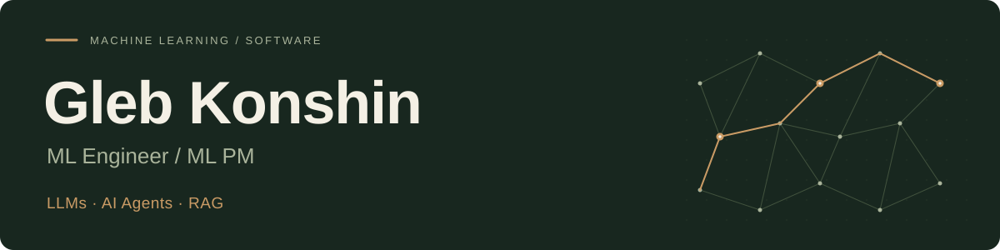

  

[LinkedIn](https://www.linkedin.com/in/konshingleb/) · [Repositories](https://github.com/YaMosly?tab=repositories)

## About

I work on **classical machine learning, NLP, LLMs and AI agents**. I also build backend tools and Android applications.

**Currently:** ML Engineer at Ozon Tech. **Previously:** Avito and T-Bank.

My academic background is in **Mathematics and Computer Science at MIPT and IITP RAS**. I study stochastic processes in finance and explore quantitative finance and high-frequency trading.

## Selected projects

| Project | What I built |
| :--- | :--- |
| **[NOIR](https://github.com/YaMosly/NOIR-flac-audio-player)** Android FLAC player | Offline playback, adaptive shuffle and an experimental direct USB audio pipeline. **Kotlin · Jetpack Compose · C++ · Android NDK** |
| **[CollabLearn](https://github.com/YaMosly/collab-learn)** Collaborative coding | A shared HTML/CSS editor with live preview, real-time synchronization, conflict-aware saving and draft recovery. **Go · JavaScript · WebSockets · PostgreSQL · Redis · Docker** |

## Toolkit

**ML & AI**

  
  
  
  
  
  

**Languages**

  
  
  
  
  
  

**Engineering**

  
  
  
  
  

